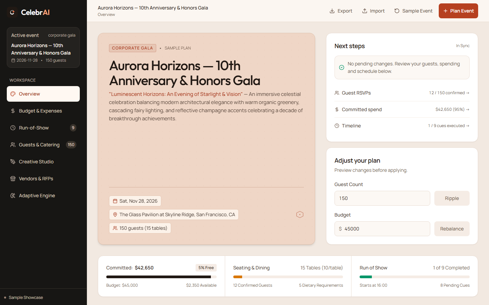
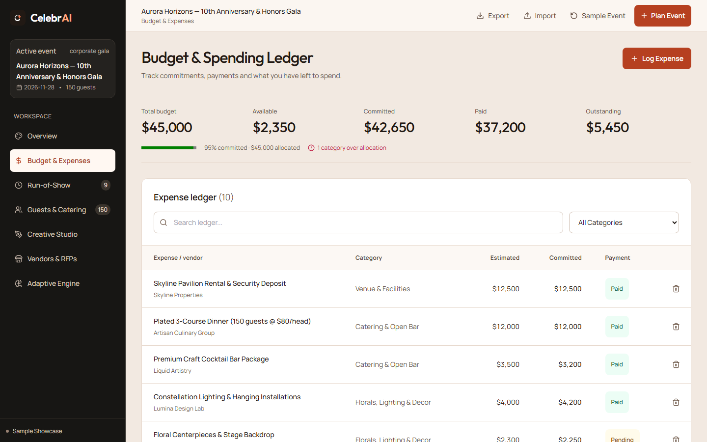
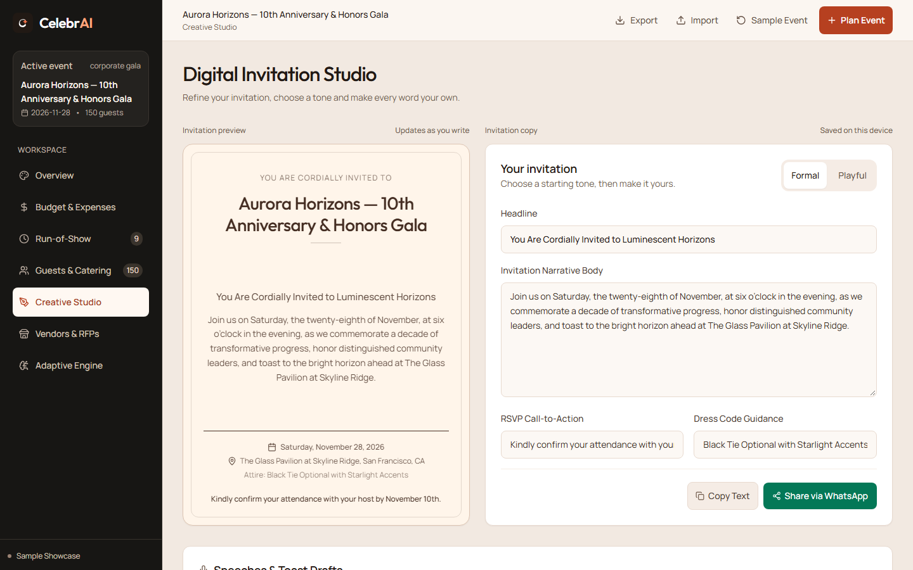

# CelebrAI

CelebrAI is a celebration and event planner built for Hack2skill PromptWars, Challenge 5. It connects event concepts, budgeting, guests, schedules, invitations and vendor checklists in one browser workspace.

[Open the app](https://celebr-ai-seven.vercel.app/) · [Public repository](https://github.com/Abhinav-0311/CelebrAI)

## Try it

The app opens with a clearly labelled **Sample Showcase** event. Use **Plan Event** to create a wedding, birthday, corporate gala, anniversary, baby shower or themed party. Enter your event details and generate a plan, then edit it across the workspace.

- **Overview:** theme, event details and quick adjustments to headcount or total budget.
- **Budget & Expenses:** category allocations, paid and pending expenses, and remaining headroom. Currency uses integer cents.
- **Timeline:** editable milestones, status tracking, printable run-of-show and day-of mode.
- **Guests:** RSVP tracking, seating and dietary summaries.
- **Creative Studio:** editable invitations in four tones, speech drafts, playlist ideas and party games. Copy invitation text or open WhatsApp with a draft.
- **Vendors:** category checklists and inquiry drafts. Open a draft in your mail app and choose the recipient before sending.
- **Adaptive Intelligence:** preview the effects of headcount or budget changes before applying them. Protected commitments and infeasible budgets are checked by the shared calculation engine.

Plans are saved in this browser's local storage. Export JSON for backup or transfer to another browser; import validates the file before replacing the current plan. Invitation previews contain RSVP wording; there is no hosted guest response portal.

## GenAI services and fallback

Google Gemini, through the server-side `@google/genai` SDK and `/api/gemini` endpoint, generates structured event concepts, allocations, timelines, catering guidance, vendor drafts, invitations and speeches. The server validates and normalizes the response before the app uses it. Model candidates and the optional `GEMINI_MODEL` setting are defined in [api/gemini.ts](api/gemini.ts).

The mode indicator distinguishes **Sample Showcase**, **Live AI Engine** and **Offline Engine**. If a key is missing, a request fails or a response is invalid, a deterministic planner creates the plan. A successful plan does not by itself prove that a live model responded.

The Gemini key stays on the server. Generation sends the event brief, including title, date and location; guest rosters and expense records are not included. Email and phone patterns in special notes are redacted, but this is not comprehensive anonymization. Avoid confidential details in the event brief. There are no accounts or cloud plan synchronization.

## Run locally

Use Node.js 22 or newer and npm.

```sh
git clone https://github.com/Abhinav-0311/CelebrAI.git
cd CelebrAI
npm ci
npm run dev
```

Open the URL printed by Vite, normally `http://localhost:5173`. Without a server key, event creation uses the offline planner.

For live generation locally, set `GEMINI_API_KEY` in the shell **before** starting Vite. For example, in PowerShell:

```powershell
$env:GEMINI_API_KEY = Read-Host 'Gemini API key'
npm run dev
```

Use [.env.example](.env.example) as a list of server settings. Vite's local API middleware reads process environment variables; it does not load that file into `process.env`. Never use a `VITE_` prefix for the secret or commit an actual key.

## Verify

```sh
npm run typecheck
npm run lint
npm test
npm run build
npx playwright install chromium
npm run test:e2e -- --prod
```

The current suite has **60 unit/integration tests** and **9 browser journeys** covering planning, navigation, adaptive changes, expense entry, guests and persistence. E2E screenshots go to ignored `test-results/screenshots/`, or to `ARTIFACT_DIR/screenshots/` when configured. These are functional browser checks, not pixel-diff visual regression tests.

For a hosted deployment, verify the frontend, API guards, exact allocation reconciliation and reported engine mode:

```sh
npm run test:deployed -- https://celebr-ai-seven.vercel.app/ --require-live
```

The `--require-live` flag fails when the server falls back. Omit it if checking offline availability is sufficient. Browser checks include keyboard navigation, dialog focus, invitation editing and 320–1440 px layouts; a full accessibility certification and physical-device testing have not been performed.

## Deploy

Import the repository into Vercel, select Vite, use `npm run build`, and set the output directory to `dist`. The Node function at `/api/gemini` is configured in [vercel.json](vercel.json). Set `GEMINI_API_KEY` in the Vercel project's server environment for live generation. `npm run preview` serves the static production build locally; it does not run Vercel functions.

## Screenshots





[Mobile overview](screenshots/overview-mobile.png)

## Structure and credits

- `src/components/`: event workspaces and shared controls.
- `src/store/eventStore.ts`: persisted event state and editing actions.
- `src/services/`: AI client, offline planner, adaptive calculations and privacy filtering.
- `src/types/`: TypeScript contracts, schemas and currency helpers.
- `src/test/`: unit and integration coverage.
- `api/gemini.ts`: validated server-side generation proxy.
- `scripts/`: local and hosted browser verification.

Built with React, TypeScript, Vite, Tailwind CSS, Zustand and Zod. Icons use Lucide. Manrope and Outfit are served locally; their SIL Open Font License files are included in `public/fonts/`. The dashboard's visual direction was inspired by [Kuldeep Jiyani's project management dashboard](https://www.figma.com/community/file/1252141522555715905/project-management-dashboard-free).
